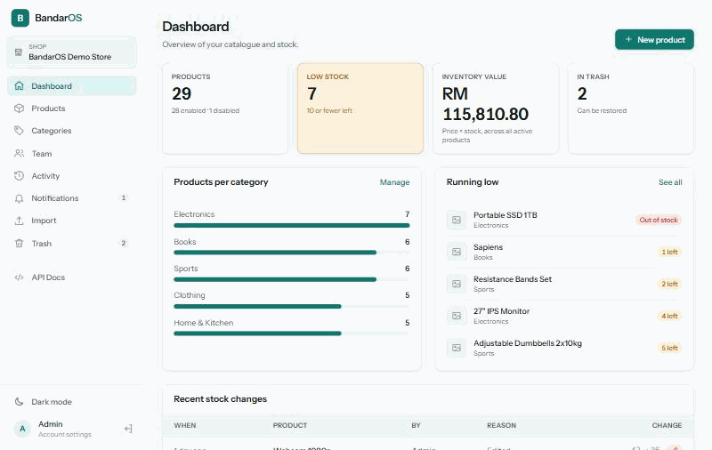
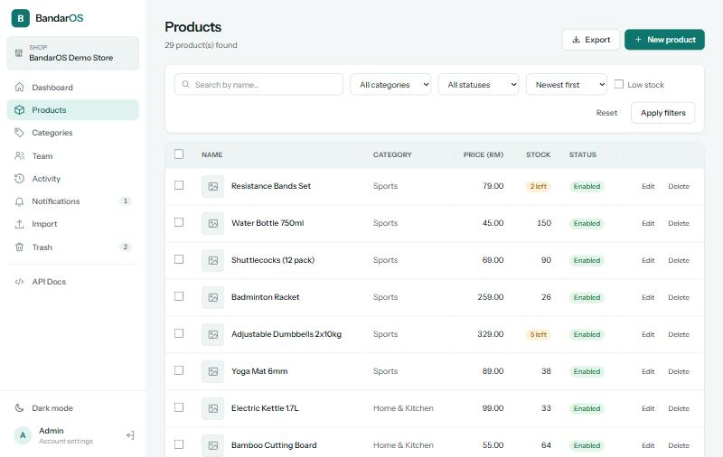
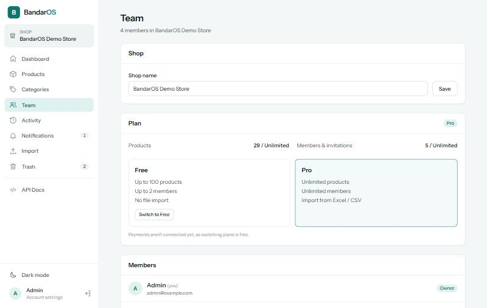
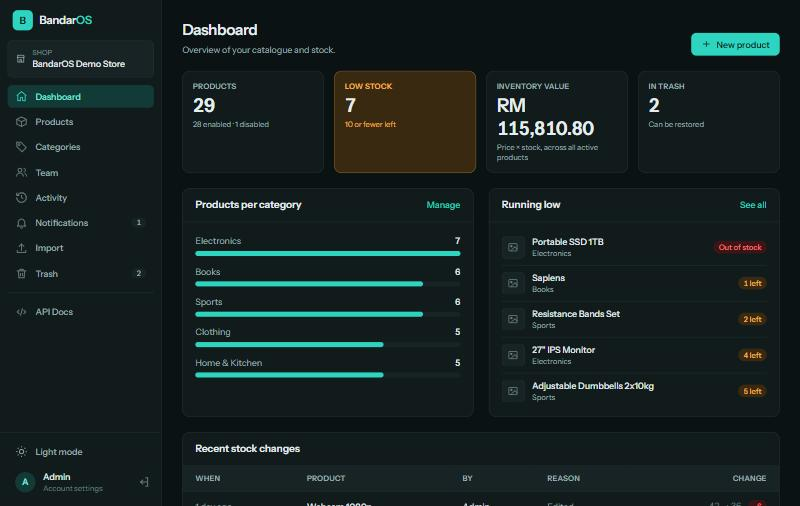
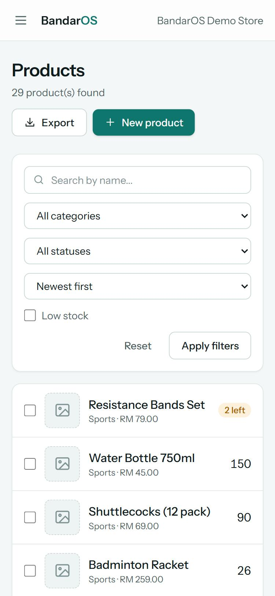

# BandarOS

[](https://github.com/AsrafAbdiah/laravel-product-admin/actions/workflows/ci.yml)

Inventory management for small shops: a multi-tenant SaaS built with Laravel 13.

Each shop (team) gets its own products, categories, stock history and members, fully isolated from other shops.



<sub>Demo: the dashboard flags low stock → filter the product list → restock an out-of-stock item → it's recorded in the stock history and the audit log → dark mode.</sub>

<table>
  <tr>
    <td width="50%"></td>
    <td width="50%"></td>
  </tr>
  <tr>
    <td width="50%"></td>
    <td width="50%" align="center"></td>
  </tr>
  <tr>
    <td align="center"><sub>Products: filters, stock badges, bulk actions</sub></td>
    <td align="center"><sub>Team: plan usage, members and roles · Dark mode · Mobile</sub></td>
  </tr>
</table>

## Features

- **Inventory:** products with images, categories, search, filters and sorting; trash with restore; stock history; Excel/CSV import and export
- **Teams and roles:** sign up creates your shop; invite members by email; Owner, Admin, Staff and Viewer roles (spatie/laravel-permission in teams mode); switch between shops
- **Security:** two-factor login, email verification, password reset (Fortify); nonce-based Content-Security-Policy and security headers; session management; per-team API rate limits; audit log of every change
- **Automation:** low-stock alerts (in-app and email), background imports and exports, weekly stock summary email, scheduled clean-up
- **Plans:** Free (100 products, 2 members, no import) and Pro (unlimited); payments not connected yet
- **REST API** with Sanctum tokens (read-only or read-write), documented with Swagger at `/api/documentation`
- **UI:** sidebar app shell, Ctrl+K command palette to jump to any page or product, dark mode, toasts, confirm dialogs, mobile layouts (Blade, Tailwind 4, Alpine.js)
- **Onboarding:** a public website (landing page, pricing built from the real plan limits, terms, privacy) and a "Get your shop set up" checklist for new shops

## Getting started

Requirements: PHP 8.3+ (gd, zip, intl, pdo_mysql, fileinfo), Composer, MySQL/MariaDB, Node 20+.

```bash
composer install
npm install && npm run build
cp .env.example .env && php artisan key:generate
# create a MySQL database "laravel_product_admin" (or edit DB_* in .env)
php artisan migrate --seed
php artisan storage:link
php artisan l5-swagger:generate
php artisan serve
```

For background work and scheduled tasks, also run `php artisan queue:work` and `php artisan schedule:work`. Emails go to `storage/logs/laravel.log` locally.

### Demo accounts (password: `password`)

| Email | Shop | Role |
|---|---|---|
| admin@example.com | BandarOS Demo Store (Pro) | Owner |
| manager@example.com | BandarOS Demo Store | Admin |
| staff@example.com | BandarOS Demo Store | Staff |
| user@example.com | BandarOS Demo Store | Viewer |
| siti@example.com | Kedai Kopi Siti (Free) | Owner |

## Roles

| Permission | Owner | Admin | Staff | Viewer |
|---|:-:|:-:|:-:|:-:|
| View products, dashboard, export | ✓ | ✓ | ✓ | ✓ |
| Create and edit products, import | ✓ | ✓ | ✓ | |
| Delete, trash, categories | ✓ | ✓ | | |
| Invite members, change roles, audit log | ✓ | ✓ | | |
| Change the plan | ✓ | | | |

## API

Log in with `POST /api/login` (or create a token under Account settings > API tokens) and send `Authorization: Bearer <token>`. Requests act on your current shop. Read-only tokens get 403 on anything that changes data. Full interactive docs are at `/api/documentation`.

## How it works

- **Multi-tenancy:** a `BelongsToTeam` trait adds a global scope (`team_id = current team`) and fills `team_id` on new rows. `SetCurrentTeam` middleware sets the team for each request, and runs *before* route model binding, so another shop's records return 404. Validation rules are team-scoped too (`TeamRule`).
- **Authorization:** policies check the role's permissions in the current team plus plan limits, and return clear "upgrade" messages.
- **Stock history:** a model observer records every stock change; Laravel `Context` labels imports.
- **Audit log:** spatie/laravel-activitylog, scoped per team.
- **Tests:** 213 PHPUnit tests, including tenant-isolation and role-matrix suites. Pint and Larastan (level 5) run in CI (`.github/workflows/ci.yml`).

```bash
php artisan test
vendor/bin/pint --test
vendor/bin/phpstan analyse
```

## Deploying

Set `APP_URL`, `DB_*`, `MAIL_*` and `QUEUE_CONNECTION=database` in `.env`. Run `php artisan migrate --force`, `php artisan storage:link` and `php artisan optimize`; keep a queue worker running (e.g. Supervisor); add one cron entry: `* * * * * php artisan schedule:run`. Serve over HTTPS so HSTS is sent.

## Roadmap

Passkey login, Stripe billing for Pro, product variants, multi-location stock.
